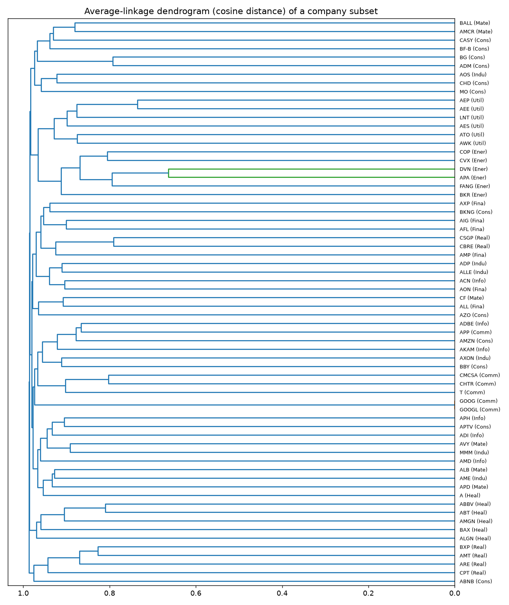
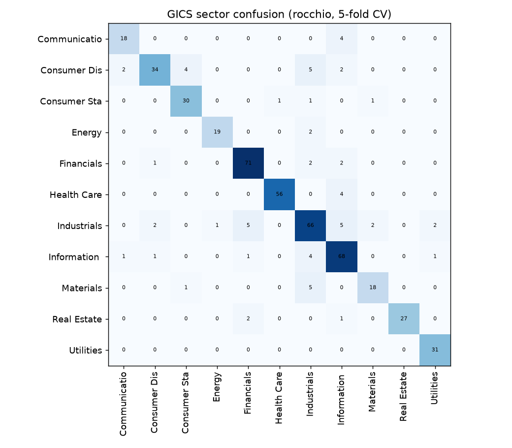
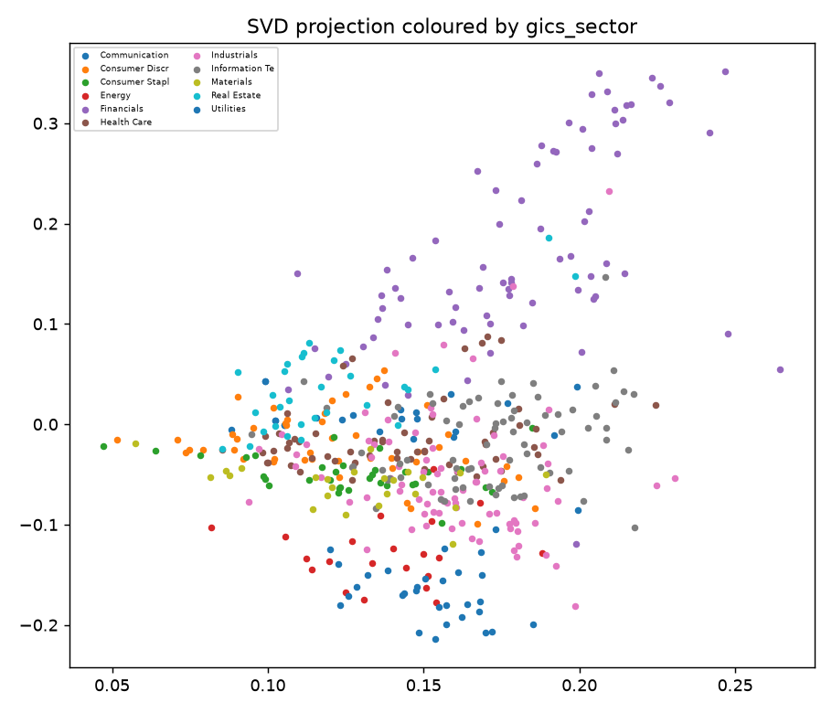
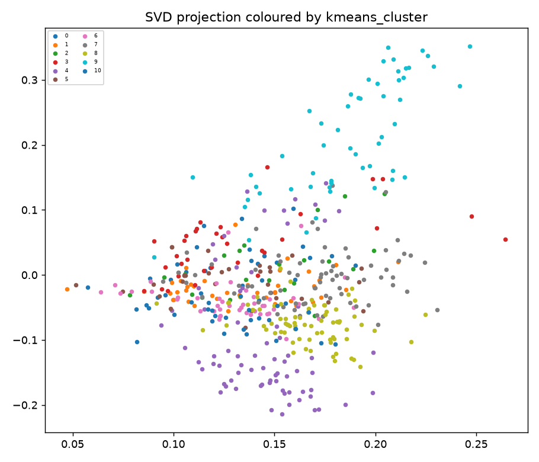

# WhyMoved: explaining abnormal stock moves with retrieval, evaluated against SEC 8-K filings

_Generated programmatically from `reports/results.json`. This is not investment advice._

## Abstract

We study two linked questions in a small information-retrieval system over S&P 500 data. (1) Given an abnormal daily stock move, which news or SEC 8-K documents best explain it, when SEC 8-K filings serve as an independent answer key? (2) Does a benchmark built from text-similar companies identify company-specific event days better than the market or the official GICS sector? The H1 and H2 experiments were not run in this build: they need SEC 8-K filings, which require a declared `EDGAR_USER_AGENT`. Text clusters from business descriptions agree moderately with GICS sectors (k-means NMI 0.46, ARI 0.33; average-linkage NMI 0.63, ARI 0.50; label-shuffled NMI 0.05).

## 1. Introduction

Large stock moves invite the question "why?". We build WhyMoved: a pipeline that (i) flags abnormal moves with a rolling market model, (ii) retrieves candidate explanations from news and 8-K filings with from-scratch IR components (positional index, BM25, TF-IDF, Rocchio feedback), and (iii) evaluates the ranking against 8-K filings. A companion module clusters companies by their business descriptions and feeds text-based peers back into the abnormal-return model.

**Hypotheses.** H1: on flagged moves coinciding with an 8-K, direction-aware query expansion + pseudo-relevance feedback + a time prior rank the true 8-K above plain BM25. H2: text peers separate company-specific news days better than the market alone or the GICS sector.

## 2. Related Work

- Del Corro and Hoffart, *Automatic identification of financially relevant news using stock price movements* (arXiv:2001.09466).
- Boudoukh, Feldman, Kogan and Richardson, *Which News Moves Stock Prices? A Textual Analysis* (NBER w18725).
- Cutler, Poterba and Summers, *What Moves Stock Prices?* (NBER w2538).
- Dong, Fan and Peng, *FNSPID: A Comprehensive Financial News Dataset in Time Series* (arXiv:2402.06698).
- TODO: add more.

Using price movements as weak labels for relevant news is prior work. The change here is to evaluate retrieval against SEC 8-K filings as an independent answer key, and to compare benchmarks (market / GICS / text peers) for deciding what counts as abnormal.

## 3. Data

Period 2021-01-01 to 2023-12-29; DEV = 2021-01-01..2021-12-31 (all tuning), TEST = 2022-01-01..2023-12-29 (all reported numbers). Constituents and GICS labels: Wikipedia (current S&P 500). Descriptions: yfinance `longBusinessSummary` with Wikipedia fallback. Prices: yfinance adjusted close (SPY as market proxy). News: FNSPID (`nasdaq_exteral_data.csv`; the other news file ends in mid-2020). Filings: SEC EDGAR submissions API and primary documents. A document's *effective day* is its timestamp in America/New_York: same day if before 16:00 on a trading day, else the next trading day.

## 4. Methods

**IR core (from scratch).** Tokenizer (lowercase, `[a-z0-9]+`, sklearn stop words, Porter stem), positional inverted index with phrase and boolean queries, TF-IDF cosine (tf = 1+log10 tf, idf = log10 N/df), BM25 (k1 = 1.2, b = 0.75; term-at-a-time with heap top-k), k-gram/Levenshtein/Soundex/wildcard entity resolution, Rocchio feedback. **Abnormal moves.** OLS market model on 120 trading days ending 11 days before the event; flag |z| >= 3 and |r| >= 2%. **Retrieval.** Query = company name + ticker (weight 1) + up/down lexicon (tuned weight); candidate window = effective days {t-1, t}; hard mode pools all tickers without a ticker filter, easy mode filters to the ticker. **Cause classifier.** Multinomial NB, Rocchio centroid, kNN, item numbers and titles removed to prevent label leakage. **Sectors.** TF-IDF (1-2 grams) on descriptions, spherical k-means with k-means++, average-linkage clustering, PageRank/HITS on a directed 10-NN graph (power iteration). **H2.** Three rolling models M0 (market), M1 (+ GICS-sector mean), M2 (+ text-peer mean); score = |z|; target = an 8-K is effective for the ticker-day.

## 5. Experiments

H1 ablations A0..A6 and H2 models M0..M2 are evaluated on TEST only, with 1000-resample bootstrap 95% CIs over moves (H1) or ticker-days (H2) and paired bootstrap tests. Supporting experiments: text clusters vs GICS (NMI, ARI, purity, with a label-shuffled baseline), sector classification (5-fold CV), cause classification.

## 6. Results

### H1

_Not run in this build (no 8-K data)._

### H2

_Not run in this build (no 8-K data)._

### Sector module

| method | NMI | ARI | purity |
|---|---|---|---|
| kmeans_k11 | 0.458 | 0.334 | 0.573 |
| hierarchical_k11 | 0.635 | 0.498 | 0.632 |

| model | accuracy | macro_F1 |
|---|---|---|
| nb | 0.863 | 0.862 |
| rocchio | 0.871 | 0.877 |
| knn | 0.849 | 0.838 |

Peer-sector purity 0.707 vs random 0.113.

See `RESULTS.md` for every table in full.

## 7. Limitations

- **Survivorship:** only current S&P 500 members are used.
- **Time mismatch:** business descriptions are current-day, prices are historical.
- **Narrow news sources:** FNSPID news (here essentially one publisher domain) covers a small set of sources, which also limits the source-reputation prior.
- **Conservative relevance:** strict relevance counts different documents about the same event as non-relevant.
- **8-K coverage:** 8-Ks cover only some event types; many large moves have no public explanation (the 'unexplained' flag is a heuristic).
- **Association, not causality:** a same-day filing means a *likely* cause, not proven causality.
- **Leakage from reaction news:** news written in reaction to the move can leak in (price-move headlines are measured by an optional ablation).
- Cause-classifier labels derive from 8-K item numbers (removed from the text), so it learns filing language and transfers imperfectly to news.

## 8. Conclusion

See the verdict sentences above; null or negative results are reported as such. This is not investment advice.
