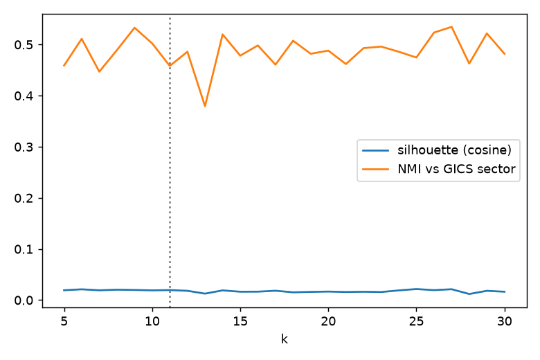
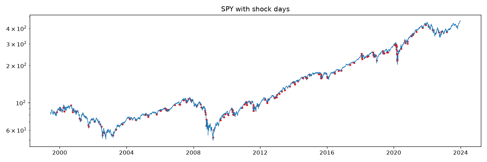

# WhyMoved: explaining abnormal stock moves with retrieval, evaluated against SEC 8-K filings

_Generated programmatically from `reports/results.json`. This is not investment advice._

## Abstract

We study two linked questions in a small information-retrieval system over S&P 500 data. (1) Given an abnormal daily stock move, which news or SEC 8-K documents best explain it, when SEC 8-K filings serve as an independent answer key? (2) Does a benchmark built from text-similar companies identify company-specific event days better than the market or the official GICS sector? H1 (hard mode, final system `A5 + time prior` vs `A2 BM25 name-only`): MRR difference +0.043, paired-bootstrap p = 0.001 -> supported. H2: ROC-AUC of M2 (text peers) = 0.655 vs M0 (market) = 0.635 and M1 (GICS) = 0.657. M2 is better M0 (diff +0.0201, p = 0.004) and not distinguishable from M1 (diff -0.0021, p = 0.690). Text clusters from business descriptions agree moderately with GICS sectors (k-means NMI 0.46, ARI 0.33; average-linkage NMI 0.63, ARI 0.50; label-shuffled NMI 0.05).

## 1. Introduction

Large stock moves invite the question "why?". We build WhyMoved: a pipeline that (i) flags abnormal moves with a rolling market model, (ii) retrieves candidate explanations from news and 8-K filings with from-scratch IR components (positional index, BM25, TF-IDF, Rocchio feedback), and (iii) evaluates the ranking against 8-K filings. A companion module clusters companies by their business descriptions and feeds text-based peers back into the abnormal-return model.

**Hypotheses.** H1: on flagged moves coinciding with an 8-K, direction-aware query expansion + pseudo-relevance feedback + a time prior rank the true 8-K above plain BM25. H2: text peers separate company-specific news days better than the market alone or the GICS sector.

## 2. Related Work

- Del Corro and Hoffart, *Automatic identification of financially relevant news using stock price movements* (arXiv:2001.09466).
- Boudoukh, Feldman, Kogan and Richardson, *Which News Moves Stock Prices? A Textual Analysis* (NBER w18725).
- Cutler, Poterba and Summers, *What Moves Stock Prices?* (NBER w2538).
- Dong, Fan and Peng, *FNSPID: A Comprehensive Financial News Dataset in Time Series* (arXiv:2402.06698).
- TODO: add more.

Using price movements as weak labels for relevant news is prior work. The change here is to evaluate retrieval against SEC 8-K filings as an independent answer key, and to compare benchmarks (market / GICS / text peers) for deciding what counts as abnormal.

## 3. Data

Period 2021-01-01 to 2023-12-29; DEV = 2021-01-01..2021-12-31 (all tuning), TEST = 2022-01-01..2023-12-29 (all reported numbers). Constituents and GICS labels: Wikipedia (current S&P 500). Descriptions: yfinance `longBusinessSummary` with Wikipedia fallback. Prices: yfinance adjusted close (SPY as market proxy). News: FNSPID (`nasdaq_exteral_data.csv`; the other news file ends in mid-2020). Filings: SEC EDGAR submissions API and primary documents. A document's *effective day* is its timestamp in America/New_York: same day if before 16:00 on a trading day, else the next trading day.

## 4. Methods

**IR core (from scratch).** Tokenizer (lowercase, `[a-z0-9]+`, sklearn stop words, Porter stem), positional inverted index with phrase and boolean queries, TF-IDF cosine (tf = 1+log10 tf, idf = log10 N/df), BM25 (k1 = 1.2, b = 0.75; term-at-a-time with heap top-k), k-gram/Levenshtein/Soundex/wildcard entity resolution, Rocchio feedback. **Abnormal moves.** OLS market model on 120 trading days ending 11 days before the event; flag |z| >= 3 and |r| >= 2%. **Retrieval.** Query = company name + ticker (weight 1) + up/down lexicon (tuned weight); candidate window = effective days {t-1, t}; hard mode pools all tickers without a ticker filter, easy mode filters to the ticker. **Cause classifier.** Multinomial NB, Rocchio centroid, kNN, item numbers and titles removed to prevent label leakage. **Sectors.** TF-IDF (1-2 grams) on descriptions, spherical k-means with k-means++, average-linkage clustering, PageRank/HITS on a directed 10-NN graph (power iteration). **H2.** Three rolling models M0 (market), M1 (+ GICS-sector mean), M2 (+ text-peer mean); score = |z|; target = an 8-K is effective for the ticker-day.

### 4b. Add-on methods (shock mode, search hardening)

**Shock days.** A market-wide shock day has |z_SPY| >= 2.5 and |r_SPY| >= 1.5% (z uses the previous 60 trading days, lagged one day) or a one-day VIX-change z >= 3; shock days within 10 trading days form one episode. **Features** use data up to the close of day t only (returns, drawdown, realised volatility, VIX level and changes, sector dispersion, breadth, sector-relative returns, volume ratio), standardised with a scaler fitted on DEV (<= 2014) and then frozen. **Day documents** concatenate up to 400 FNSPID headlines per effective trading day (extra stop words: tickers, company and publisher names, months, weekdays); T1 is TF-IDF with IDF frozen on DEV; T2 (*burst weighting*) divides the term frequency by its mean over the previous 60 trading days (+1) before applying IDF. **Library rule (no look-ahead).** For a query shock day q the library holds shock days whose 20-day forward window finished before q and that belong to a different episode. **Fusion** z-scores the numeric and text similarities within the library and mixes them with a DEV-tuned weight; reciprocal rank fusion is also reported. Uncertainty uses an episode-block bootstrap. **Search hardening.** A seeded, rule-based corruption benchmark for tolerant retrieval, an efficiency benchmark against a brute-force reference, and gap + variable-byte postings compression.

## 5. Experiments

H1 ablations A0..A6 and H2 models M0..M2 are evaluated on TEST only, with 1000-resample bootstrap 95% CIs over moves (H1) or ticker-days (H2) and paired bootstrap tests. Supporting experiments: text clusters vs GICS (NMI, ARI, purity, with a label-shuffled baseline), sector classification (5-fold CV), cause classification.

## 6. Results

### H1

Counts: {'dev_flagged': 120, 'dev_with_gold': 34, 'test_flagged': 305, 'test_with_gold': 142, 'test_without_gold': 163}.

**Hard mode**

| system | n | MRR [95% CI] | R@1 | R@5 | R@10 | nDCG@10 | dMRR vs A2 | p vs A2 |
|---|---|---|---|---|---|---|---|---|
| A0 random | 142 | 0.018 [0.012, 0.025] | 0.000 [0.000, 0.000] | 0.014 [0.000, 0.035] | 0.038 [0.009, 0.070] | 0.015 [0.004, 0.028] | -0.053 | 0.001 |
| A1 TF-IDF name-only | 142 | 0.067 [0.048, 0.090] | 0.014 [0.000, 0.035] | 0.060 [0.025, 0.102] | 0.134 [0.077, 0.197] | 0.057 [0.031, 0.085] | -0.004 | 0.008 |
| A2 BM25 name-only | 142 | 0.071 [0.052, 0.094] | 0.014 [0.000, 0.035] | 0.053 [0.021, 0.092] | 0.144 [0.088, 0.204] | 0.061 [0.034, 0.089] |  |  |
| A3 BM25 + direction | 142 | 0.071 [0.051, 0.094] | 0.014 [0.000, 0.035] | 0.056 [0.021, 0.095] | 0.141 [0.085, 0.197] | 0.061 [0.034, 0.089] | -0.000 | 0.920 |
| A4 + Rocchio PRF | 142 | 0.071 [0.051, 0.094] | 0.014 [0.000, 0.035] | 0.056 [0.021, 0.095] | 0.141 [0.085, 0.197] | 0.061 [0.034, 0.089] | -0.000 | 0.920 |
| A5 + time prior | 142 | 0.114 [0.084, 0.149] | 0.039 [0.011, 0.070] | 0.106 [0.060, 0.159] | 0.268 [0.201, 0.345] | 0.122 [0.084, 0.163] | +0.043 | 0.001 |

**Easy mode**

| system | n | MRR [95% CI] | R@1 | R@5 | R@10 | nDCG@10 | dMRR vs A2 | p vs A2 |
|---|---|---|---|---|---|---|---|---|
| A0 random | 142 | 0.272 [0.219, 0.330] | 0.158 [0.099, 0.222] | 0.331 [0.260, 0.412] | 0.569 [0.493, 0.655] | 0.322 [0.266, 0.383] | +0.103 | 0.001 |
| A1 TF-IDF name-only | 142 | 0.165 [0.120, 0.219] | 0.099 [0.049, 0.155] | 0.151 [0.095, 0.215] | 0.243 [0.176, 0.324] | 0.155 [0.106, 0.213] | -0.003 | 0.042 |
| A2 BM25 name-only | 142 | 0.169 [0.124, 0.222] | 0.099 [0.049, 0.155] | 0.151 [0.095, 0.211] | 0.250 [0.183, 0.327] | 0.158 [0.109, 0.217] |  |  |
| A3 BM25 + direction | 142 | 0.171 [0.127, 0.226] | 0.099 [0.049, 0.155] | 0.155 [0.099, 0.218] | 0.254 [0.187, 0.331] | 0.161 [0.111, 0.219] | +0.002 | 0.716 |
| A4 + Rocchio PRF | 142 | 0.171 [0.127, 0.226] | 0.099 [0.049, 0.155] | 0.155 [0.099, 0.218] | 0.254 [0.187, 0.331] | 0.161 [0.111, 0.219] | +0.002 | 0.716 |
| A5 + time prior | 142 | 0.211 [0.163, 0.266] | 0.123 [0.074, 0.183] | 0.190 [0.127, 0.257] | 0.397 [0.317, 0.480] | 0.224 [0.174, 0.283] | +0.042 | 0.001 |

Tuned on DEV: {'direction_w': 0.1, 'prf': None, 'lambda': 2.0, 'dev_mrr': {'A3': 0.06866732035579305, 'A4': 0.06822216037716451, 'A5': 0.1183001928304156}}

'Unexplained' heuristic (tau from DEV): {'tau': 3.6810623927790247, 'heuristic': True, 'share_goldless_below_tau': 0.12269938650306748, 'share_gold_below_tau': 0.07042253521126761, 'n_goldless': 163}

### H2

H2: ROC-AUC of M2 (text peers) = 0.655 vs M0 (market) = 0.635 and M1 (GICS) = 0.657. M2 is better M0 (diff +0.0201, p = 0.004) and not distinguishable from M1 (diff -0.0021, p = 0.690).

| model | roc_auc | roc_auc_lo | roc_auc_hi | pr_auc | pr_auc_lo | pr_auc_hi | top200_share_with_8k | z_std |
|---|---|---|---|---|---|---|---|---|
| M0 market | 0.635 | 0.614 | 0.655 | 0.198 | 0.172 | 0.224 | 0.575 | 1.066 |
| M1 market+GICS sector | 0.657 | 0.637 | 0.677 | 0.215 | 0.188 | 0.244 | 0.600 | 1.086 |
| M2 market+text peers | 0.655 | 0.635 | 0.673 | 0.213 | 0.187 | 0.242 | 0.615 | 1.090 |

### Cause classifier

| model | accuracy | macro_F1 |
|---|---|---|
| nb | 0.858 | 0.684 |
| rocchio | 0.858 | 0.702 |
| knn | 0.840 | 0.694 |
| majority | 0.283 | 0.063 |

### Sector module

| method | NMI | ARI | purity |
|---|---|---|---|
| kmeans_k11 | 0.458 | 0.334 | 0.573 |
| hierarchical_k11 | 0.635 | 0.498 | 0.632 |

| model | accuracy | macro_F1 |
|---|---|---|
| nb | 0.863 | 0.862 |
| rocchio | 0.871 | 0.877 |
| knn | 0.849 | 0.838 |

Peer-sector purity 0.707 vs random 0.113.

### Add-on: shock mode (H3-H5)

H3: best method by P@5 is `num` (0.369; empirical chance 0.331; n_queries=70, n_episodes=32). Difference vs M_vol +0.063 (p=0.128), vs random +0.037 (p=0.292) -> NOT supported (null result): not significantly better than both baselines.

H5: burst (T2) P@5 0.329 vs plain TF-IDF (T1) 0.334; difference -0.005 (p=0.780) -> NOT supported.

H4: best text model `rocchio_t1` macro-F1 0.167 (95% CI [0.095, 0.259]) vs majority 0.107 and era-only 0.134 (p vs majority 0.098, vs era-only 0.222; n_queries=70, n_episodes=32) -> NOT supported.

Era diagnostics (k=5, non-thin subset): mean |year gap| of analogs: numeric 6.7y, T1 1.0y, T2 1.3y, era-only baseline 0.6y; share of analogs within +/-2 years: numeric 0.25, T1 0.96, T2 0.89. Text similarity is dominated by vocabulary drift: text analogs come mostly from the query's own era.

Full tables (per k and subset, with CIs, n_queries and n_episodes) are in `RESULTS.md`. Analogs are descriptive, not a forecast.

See `RESULTS.md` for every table in full.

## 7. Limitations

- **Survivorship:** only current S&P 500 members are used.
- **Time mismatch:** business descriptions are current-day, prices are historical.
- **Narrow news sources:** FNSPID news (here essentially one publisher domain) covers a small set of sources, which also limits the source-reputation prior.
- **Conservative relevance:** strict relevance counts different documents about the same event as non-relevant.
- **8-K coverage:** 8-Ks cover only some event types; many large moves have no public explanation (the 'unexplained' flag is a heuristic).
- **Association, not causality:** a same-day filing means a *likely* cause, not proven causality.
- **Leakage from reaction news:** news written in reaction to the move can leak in (price-move headlines are measured by an optional ablation).
- **Shock mode:** few independent episodes (low statistical power); detection thresholds are set by hand and checked on DEV; sector ETFs start in Dec 1998, so earlier crashes are not covered; FNSPID coverage and sources change over time (median headlines/day range from tens in 1999 to thousands around 2011), so text similarity is era-confounded; the day document mixes many unrelated stories; the curated date list is a face-validity check, not ground truth; an 8-K fetch for all constituents would have survivorship bias (current constituents only).
- Related work for analog retrieval / nearest-neighbour forecasting and event studies: TODO: literature search on market analog / nearest-neighbour forecasting and event-study methods. No novelty is claimed for analog retrieval; the contribution is the evaluation protocol (no-look-ahead library, episode-level uncertainty, era-confound checks) and the numeric+text fusion.
- Cause-classifier labels derive from 8-K item numbers (removed from the text), so it learns filing language and transfers imperfectly to news.

## 8. Conclusion

See the verdict sentences above; null or negative results are reported as such. This is not investment advice.
